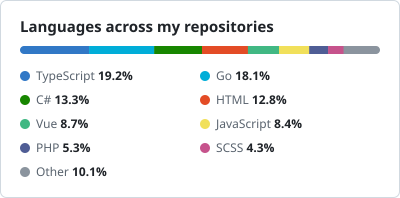
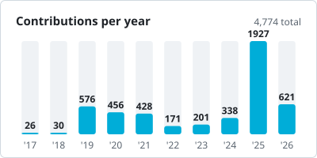

<h1 align="center">Hi, I'm Max 👋</h1>

  Senior software developer from Ukraine · developer at
  <a href="https://github.com/grassbusinesslabs">Grass Business Labs</a>

  
  
  
  
  
  
  
   
  
  
  
  
  
  
  

## About

I've spent the last ~9 years shipping full products end to end — mostly **Go** and **PHP / Laravel** backends
with **Vue / Angular / Ionic** frontends, plus **.NET** where hardware is involved.
A lot of my work sits where software meets the physical world: POS terminals, receipt printers,
fiscal registrars and mobile apps for small businesses.

- 🍽️ **Restaurant & retail platforms** — QR menus, ordering, waiter apps, POS/payment-terminal integrations (ZVT), ESC/POS printing, Ukrainian fiscal PRRO
- 🧠 **LLM-powered products** — language-learning tools, translation pipelines, automated assessment with embeddings + pgvector
- 🖥️ **Cross-platform clients** — Avalonia (.NET) desktop/Android apps talking to Go gRPC services
- 🐘 **PHP / Laravel / MySQL** — years of production APIs, admin panels and integrations on the classic LAMP/LEMP stack
- 🐧 **Linux hosting & DevOps** — I run my own servers: provisioning, Nginx, deployments, CI/CD with GitHub Actions, monitoring

**Go toolbox:** chi · echo · gin · ent · upper/db · pgx · goose / migrate · gRPC · websockets · Prometheus · OpenTelemetry

## Currently

🤖 Working with **AI coding agents** every day — **Claude Code** and **OpenAI Codex** — using
[**OpenSpec**](https://github.com/Fission-AI/OpenSpec) for spec-driven development: agree on the spec first, then let the agents implement, test and review against it.

## Open source

| Project | What it is |
|---|---|
| [**infisical-action**](https://github.com/amaneshi/infisical-action) | GitHub Action that pulls multiple secrets from Infisical into your workflow |
| [**Payterm.Zvt**](https://github.com/amaneshi/Payterm.Zvt) | .NET ZVT client for payment terminals — connection-per-transaction mode for Verifone VX820 and similar |
| [**ent** (fork)](https://github.com/amadev-net/ent) | AmaDev's fork of the ent entity framework for Go |

### 🧪 AI-agent experiments & hobby projects

Built mostly together with AI agents, to see how far they can go on real, non-trivial problems.

| Project | What it is |
|---|---|
| [**ebook-reader** (bookai)](https://github.com/amadev-net/ebook-reader) | File-based Go pipeline that turns an EPUB into a consistently translated, glossary-backed audiobook |
| [**dstucrypt**](https://github.com/amaneshi/dstucrypt) | Pure-Go Ukrainian crypto: DSTU 4145-2002 signatures, GOST 28147-89, CMS/PKCS#7, Key-6.dat & JKS keystores, OCSP/TSP |

## Activity

  
  

Cards cover public, private and organization repositories · regenerated with <code>scripts/gen_stats.py</code>

